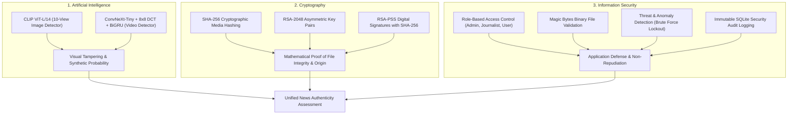

# Intelligent System for Verifying the Authenticity of Images and Videos Used in Online News

A secure, multi-domain intelligence platform that integrates **Artificial Intelligence**, **Information Security**, and **Cryptography** to verify media authenticity, detect deepfake/synthetic forgeries, enforce cryptographic provenance, and protect online journalism against malicious disinformation.

---

## 1. The Three Convergent Technical Domains



---

## 2. Directory Structure

```
ISC-UNIFIED-WEB/
├── ai_module/
│   ├── image_detection.py       # CLIP ViT-L/14 Multi-View Image Forgery Detector
│   ├── video_detection.py       # ConvNeXt-Tiny + 8x8 DCT + BiGRU Video Detector
│   └── preprocessing.py         # Multi-orientation face tracker & scene extractor
├── cryptography_module/
│   ├── hashing.py               # SHA-256 streaming media hasher
│   ├── key_generation.py        # RSA-2048 keypair generation & fingerprinting
│   ├── digital_signature.py     # RSA-PSS digital signature generator
│   └── signature_verification.py# RSA-PSS verification & tamper detector
├── security_module/
│   ├── authentication.py        # Password hashing & brute-force lockout
│   ├── access_control.py        # RBAC decorators (@admin_required, @journalist_required)
│   ├── file_validation.py       # Magic bytes inspection & filename sanitization
│   ├── threat_detection.py      # Real-time alert generation for security anomalies
│   └── security_logging.py      # SQLite audit logging & file audit trail
├── database/
│   ├── database.py              # SQLite schemas & connection management
│   └── database.db              # SQLite relational store
├── backend/
│   ├── app.py                   # Flask application factory
│   └── routes.py                # Web and API routing controllers
├── frontend/
│   ├── static/
│   │   ├── css/style.css        # Modern high-tech responsive UI theme
│   │   └── js/main.js
│   └── templates/
│       ├── base.html            # Universal navigation & alerts
│       ├── index.html           # Landing page & platform stats
│       ├── login.html           # Secure login with lockout notice
│       ├── register.html        # Registration with role selection
│       ├── verify.html          # Unified Media Verification Studio (Photo & Video)
│       ├── report.html          # Comprehensive 3-Domain Authenticity Report
│       ├── journalist_dashboard.html # Key generation & RSA-PSS media signing
│       └── admin_dashboard.html # Threat monitoring & security audit logs
├── models/
│   ├── best_video_detector.pt   # Production ConvNeXt-BiGRU video weights (118 MB)
│   └── detector_v3.joblib       # Production CLIP ViT-L/14 image detector bundle
├── uploads/                     # Secure uploaded media store
├── logs/                        # Security audit trail logs
├── run.py                       # One-click startup runner
└── requirements.txt             # Dependency specifications
```

---

## 3. How to Run the Platform

### Step 1: Open Terminal
Navigate to the unified web project folder:
```powershell
cd "C:\Users\Tankala Bhaskar teja\ISC-UNIFIED-WEB"
```

### Step 2: Start the Web Server
Run with your configured virtual environment:
```powershell
& "C:\Users\Tankala Bhaskar teja\ISC-VIDEO-KOMAL\.venv\Scripts\python.exe" run.py
```

### Step 3: Open in Browser
Visit:
```
http://127.0.0.1:5000
```

---

## 4. Default Credentials

| Role | Username | Password | Privileges |
| :--- | :--- | :--- | :--- |
| **System Administrator** | `admin` | `Admin@12345` | Manage users, approve journalists, view security logs, resolve threat alerts |
| **Verified Journalist** | `reuters_editor` | `Journo@12345` | Generate RSA-2048 keys, sign original photos/videos, download digital signatures |
| **General User** | Self-registered | Self-registered | Upload media for verification, view public authenticity reports |

---

## 5. End-to-End Demonstration Scenarios

### Scenario 1: Verification of an Authentic Signed News Photograph
1. Log in as `reuters_editor`.
2. Generate an RSA-2048 keypair in the **Journalist Portal** and download the private key (`.pem`).
3. Upload an original photograph and sign it using your private key.
4. Navigate to the **Verify Media** portal, upload the photo, and attach the signature.
5. **Expected Output**:
   - Cryptographic Status: `VERIFIED GENUINE` (Signed by Sarah Jenkins, Reuters Wire).
   - AI Forgery Status: `AUTHENTIC (REAL PHOTOGRAPH)` ($< 20\%$ AI probability).
   - Final Assessment: `AUTHENTIC & VERIFIED`.

### Scenario 2: Tampering Detection (Bit Manipulation)
1. Open the original photograph in an image editor or alter 1 byte.
2. Upload the altered photograph along with the original signature to the **Verify Media** portal.
3. **Expected Output**:
   - Cryptographic Status: `TAMPERED OR INVALID SIGNATURE`.
   - Security Alert: Automatically logs a `SIGNATURE_FORGERY` security event in the Admin Console.
   - Final Assessment: `CRYPTOGRAPHIC INTEGRITY FAILED`.

### Scenario 3: AI Deepfake Video Verification
1. Navigate to **Verify Media**.
2. Upload a deepfake video (e.g. Tom Cruise or Morgan Freeman).
3. The system automatically routes the file to the **ConvNeXt + 8x8 DCT + BiGRU** temporal engine.
4. **Expected Output**:
   - AI Forgery Status: `AI MANIPULATED (DEEPFAKE)` ($> 80\%$ AI probability).
   - Displays individual subject breakdown and exact timestamp intervals of facial manipulation.

### Scenario 4: Security Defense & Brute Force Lockout
1. Attempt to log in with an incorrect password 5 times consecutively.
2. On the 5th attempt, the system locks the account for 15 minutes and logs a `BRUTE_FORCE_LOGIN` threat alert in the **Security Console**.
